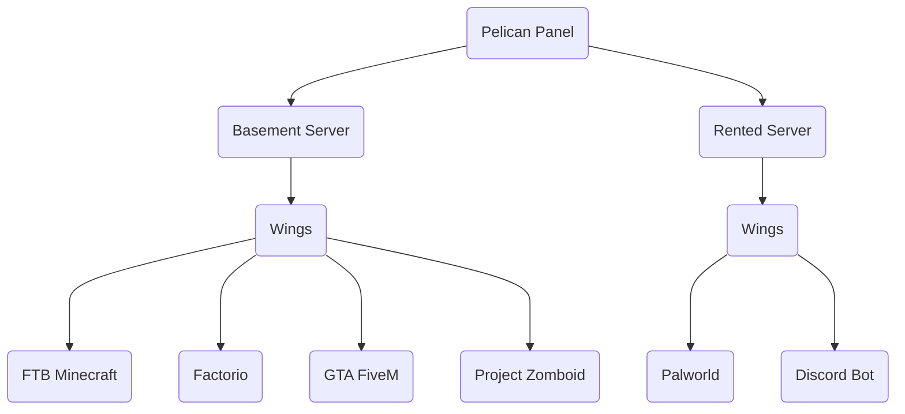

import Admonition from '@theme/Admonition';

# Welcome to Pelican!

### What is [Pelican](https://github.com/pelican/panel)?

**Pelican** is a free, open-source server management panel for hosting game servers, software and applications in isolated Docker containers.
It started as a fork of [**Pterodactyl**](https://pterodactyl.io/) and has since grown well beyond it.

The Panel is the web interface: it shows information about your servers and sends commands to them.

### What is [Wings](https://github.com/pelican/wings)?

**Wings** is the service that runs on each machine hosting your servers.
It handles the Docker containers behind the scenes (creating, starting, stopping and restarting them) on behalf of the Panel. Users never interact with Wings directly.

### Glossary

**Panel**: web application that talks to Wings and lets you control your Servers.

**Wings**: service that manages your Servers' containers on behalf of the Panel.

**Node**: machine (computer or server) that runs Wings and connects to the Panel.

**Server**: a Container managed by Wings, shown in the Panel.

**Docker**: platform that runs Servers in isolated containers.

**Docker Image**: file that contains the libraries, dependencies and files needed to run a Container.

**Container**: isolated environment that a Server runs in.

**Egg**: file that configures how a Server is installed and run, using a Docker Image.

**Yolk**: curated collection of Docker Images provided by Pelican for use with Eggs.

### Example Setup

### Open Source!

The Panel is released under [AGPLv3](https://www.gnu.org/licenses/agpl-3.0.en.html) and Wings under [MIT](https://opensource.org/license/mit).
Anyone can browse the code, contribute improvements, and help identify bugs and security issues on [GitHub](https://github.com/pelican).

<Admonition type="warning" title="🔒 Reporting Security Issues 🔒">
    If you notice anything that raises a concern, please reach out directly to **team@pelican.dev**  
    For security reasons, we ask that you handle security disclosures responsibly and **avoid posting them on GitHub.**
</Admonition>

Meet the people behind Pelican on the [Contributors](./team.mdx) page.
